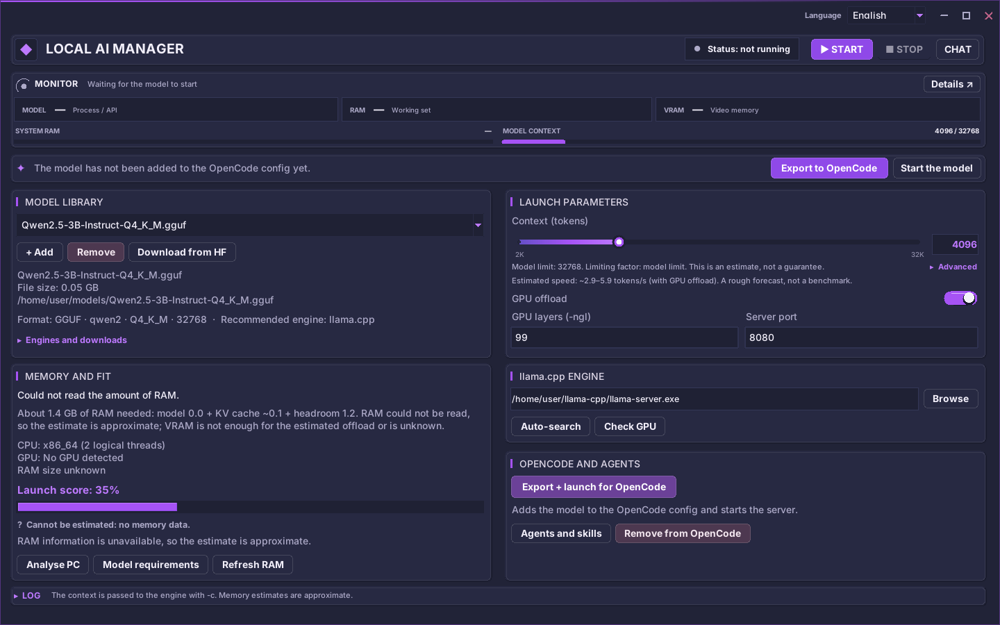
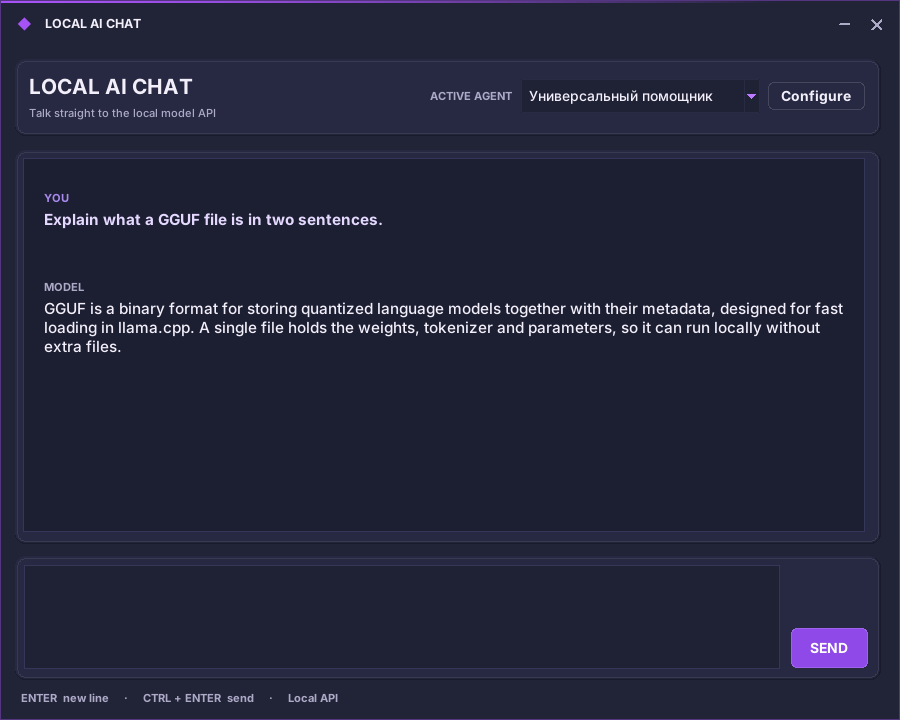

# Local AI Manager

**Local AI Manager** is a Windows desktop application for managing local language models. It helps users browse and download models from Hugging Face, estimate hardware compatibility, manage the `llama.cpp` runtime, and connect a local OpenAI-compatible API to OpenCode.

[](LICENSE)  

**Version:** 48.1.4. The project is under active development; use GitHub Releases for published binaries.



<p align="center"></p>

## Features

- Local model library for GGUF models.
- Hugging Face repository search, file browsing, selective streaming downloads, resume support, and integrity checks where available.
- RAM/VRAM analysis and context-size recommendations.
- `llama.cpp` engine discovery, download, launch, stop, and local API checks.
- OpenCode configuration export.
- Local chat, agents, and reusable skills.
- Dark graphite/purple borderless interface with its own title bar, Russian and English localization.

Actual model and engine support depends on the implemented adapter. Unsupported formats should be reported as unsupported rather than implied to work.

## Requirements

- Windows 10/11 x64.
- Python 3.10+ with Tcl/Tk to run from source.
- Internet access for optional Hugging Face searches/downloads and engine/update downloads.

## Run from source

```powershell
py -3.12 -m venv .venv
.\.venv\Scripts\Activate.ps1
python -m pip install --upgrade pip
python -m pip install -r requirements-dev.txt
python local_ai_manager.py
```

## Build

Build Windows binaries on Windows:

```powershell
build_windows.bat
```

Or use GitHub Actions: run **Build Local AI Manager for Windows** manually, or push a `v*` tag. The workflow creates a portable ZIP and an Inno Setup installer. Test both artifacts on a clean Windows 10/11 x64 machine before publishing a release.

## Privacy and security

Application settings and local model-library metadata are stored on the user's computer under `%APPDATA%\LocalAIManager`. Hugging Face requests disclose search terms/repository identifiers and use a user-provided token only when needed for gated/private repositories. Update checks and optional engine downloads contact GitHub, PyPI, and official engine sources. HTTPS certificate verification uses the Windows/Python trust store plus the bundled Mozilla CA bundle (`certifi`); certificate checks are never disabled.

The source contains no identified built-in advertising analytics or automatic upload of chat history to the project maintainer. Chat requests are sent to the configured local model server. See [PRIVACY.md](PRIVACY.md) and [SECURITY.md](SECURITY.md).

The optional local automation bridge is **disabled by default**. Arbitrary Python evaluation through that bridge requires a second explicit opt-in and should not be enabled in normal use.

## Documentation

- [Russian README](README_RU.md)
- [Privacy notice](PRIVACY.md)
- [Security policy](SECURITY.md)
- [Windows release checklist (Russian)](RELEASE_CHECKLIST_RU.md)

## License

Released under the [MIT License](LICENSE). Models and engine binaries downloaded through the application have their own licenses.
