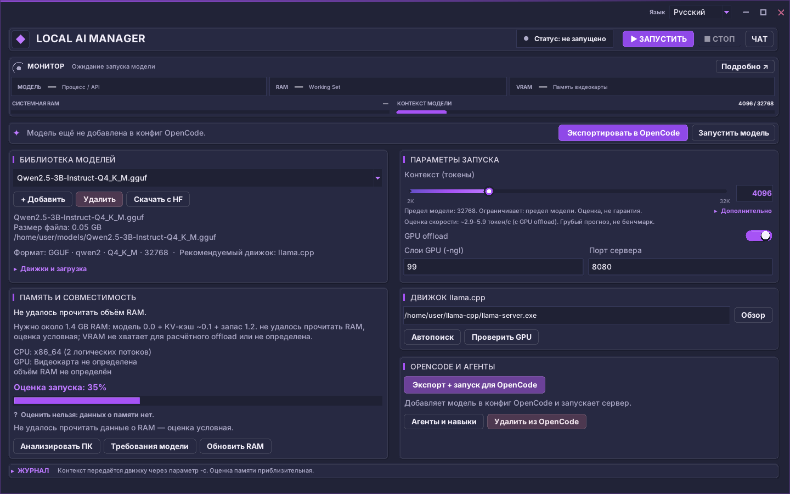

# Local AI Manager

**Local AI Manager** — настольный менеджер локальных языковых моделей для Windows. Помогает находить и загружать модели с Hugging Face, оценивать совместимость с оборудованием, управлять движком `llama.cpp` и подключать локальный OpenAI-совместимый API к OpenCode.

[](LICENSE)  

> Текущая версия: **48.1.0**. Проект развивается; готовые сборки смотрите на вкладке Releases.



## Возможности

- **Библиотека моделей:** добавление локальных GGUF-файлов, поиск и управление библиотекой.
- **Hugging Face:** поиск репозиториев, просмотр файлов, выборочная потоковая загрузка, докачка и проверка целостности поддерживаемых файлов.
- **Оценка компьютера:** анализ RAM/VRAM, оценка размещения модели и контекста, рекомендации по параметрам запуска.
- **Движок:** обнаружение и загрузка `llama.cpp`, запуск и остановка `llama-server`, проверка локального API.
- **OpenCode:** экспорт выбранной модели в конфигурацию OpenCode.
- **Агенты и чат:** локальные агенты, навыки и чат через запущенный локальный сервер.
- **Интерфейс:** тёмная графитово-фиолетовая тема, русский и английский языки.

Поддержка форматов и движков зависит от конкретной реализации. Приложение не обещает запускать любой формат модели: неподдерживаемые сценарии должны обозначаться явно.

## Быстрый запуск из исходников

Требуется Windows 10/11 x64 и Python 3.10 или новее с Tcl/Tk.

```powershell
py -3.12 -m venv .venv
.\.venv\Scripts\Activate.ps1
python -m pip install --upgrade pip
python -m pip install -r requirements-dev.txt
python local_ai_manager.py
```

Для запуска без окна консоли используйте собранный `LocalAIManager.exe`.

## Сборка Windows

Сборку Windows выполняйте на Windows, а не кросс-компиляцией из Linux.

```powershell
build_windows.bat
```

Либо отправьте тег `v*` или запустите workflow вручную:

1. Откройте GitHub → **Actions**.
2. Выберите **Build Local AI Manager for Windows**.
3. Запустите workflow и дождитесь завершения.
4. Скачайте артефакт `Local-AI-Manager-Windows-x64`.

Workflow формирует portable ZIP и установщик Inno Setup. Перед публикацией проверьте оба артефакта на чистой Windows 10/11 x64.

## Данные и конфиденциальность

- Настройки, пользовательские агенты и сведения о локальной библиотеке сохраняются на компьютере в `%APPDATA%\LocalAIManager`.
- Модели и движки скачиваются только после действий пользователя.
- Поиск и загрузка с Hugging Face передают сервису поисковые запросы, идентификаторы репозиториев и необходимые HTTP-запросы. Токен Hugging Face используется для доступа к закрытым/gated-репозиториям; не публикуйте его.
- Проверка релизов и зависимостей обращается к GitHub, PyPI и официальным источникам движков.
- Чат отправляет запросы на настроенный локальный сервер модели. Не направляйте его на недоверенный удалённый сервер.
- В исходниках не обнаружена встроенная рекламная аналитика или отправка истории чата разработчику. См. [PRIVACY.md](PRIVACY.md) и [SECURITY.md](SECURITY.md).

### Локальный мост управления

Интеграционный TCP-мост для автоматизации выключен по умолчанию. Для осознанного включения задайте `LAM_AI_BRIDGE=1`. Команда произвольного выполнения Python дополнительно отключена и требует отдельного `LAM_AI_BRIDGE_ALLOW_EVAL=1`. Не включайте эти параметры в обычной пользовательской сборке.

## Проверка

```powershell
python -m pytest -q
python -m compileall -q local_ai_manager.py ai_bridge.py lamcore
```

GUI-тесты требуют доступной графической сессии. Проверяйте запуск, сворачивание, панель задач, масштабирование DPI и установку на чистой Windows отдельно.

## Публикация

См. [RELEASE_CHECKLIST_RU.md](RELEASE_CHECKLIST_RU.md). Перед открытием репозитория удалите локальные отчёты, секреты, пользовательские конфиги и скачанные модели.

## Лицензия

Проект распространяется по лицензии [MIT](LICENSE). У моделей и движков, которые загружаются через приложение, свои лицензии.

## Обратная связь

Баги и предложения оформляйте через GitHub Issues. Не прикладывайте API-токены, личные пути, логи с чувствительными данными или приватные модели.
